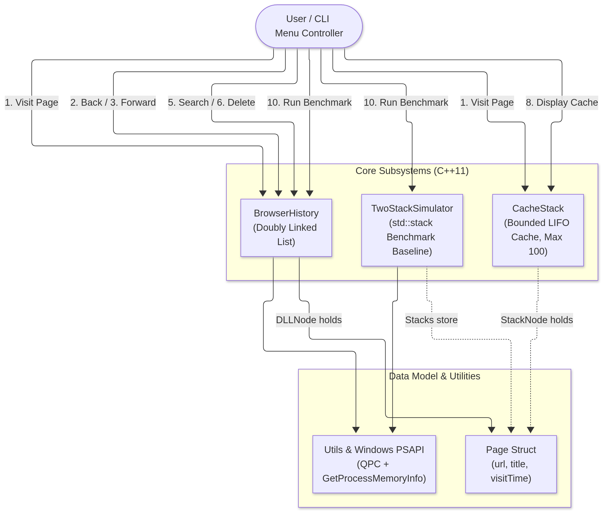
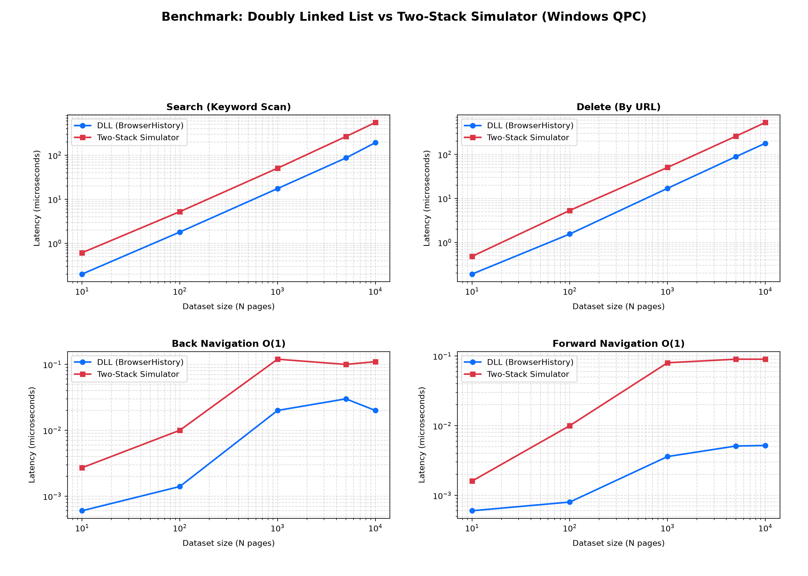
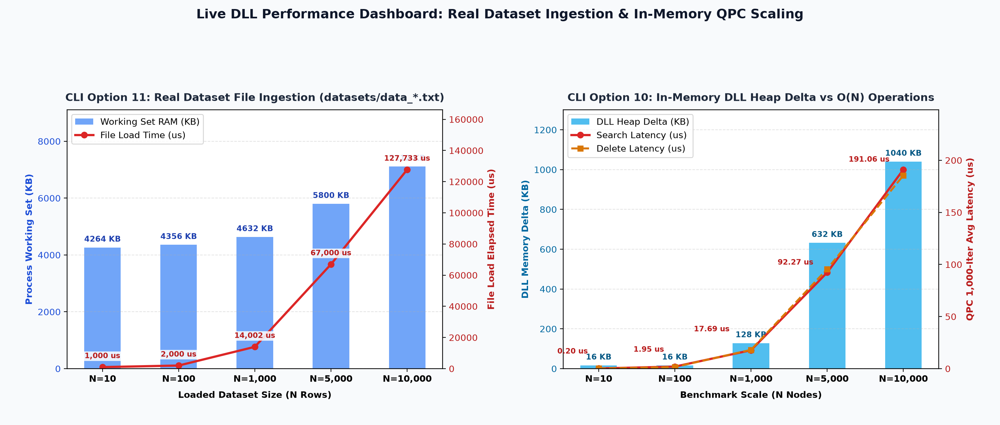

# Browser History & Cache Navigation System

A modular C++11 console application and benchmarking suite comparing a custom **Doubly Linked List** history manager and bounded **Stack Cache** against a **Two-Stack** navigation simulator (`std::stack`).

**Author:** Ha Gia Bao  
**Contact:** `weliuliu123@gmail.com`  
**Toolchain:** C++11 (`g++` / TDM-GCC-64), Windows PSAPI (`-lpsapi`), Python 3 (`matplotlib`)

---

## Development Environment & Toolchain

| Component | Specification |
| :--- | :--- |
| **Operating System** | Windows (Win32 `QueryPerformanceCounter` & `psapi.dll`) |
| **C++ Compiler** | `g++` (TDM-GCC-64) with `-std=c++11 -O2 -Wall -Wextra` |
| **Build & Link Flags** | `-Iinclude -lpsapi` (or `make all` / `make test`) |
| **Python & Plotting** | Python 3 with `matplotlib` (`scripts/generate_diagrams.py`, `scripts/plot_benchmark.py`, `scripts/plot_dll_scaling.py`) |

---

## System Architecture



- **History Engine (`BrowserHistory`):** Custom Doubly Linked List supporting `O(1)` forward/back pointer traversal, mid-history branch truncation on new visits, case-insensitive keyword search, and safe node relinking on deletion.
- **Bounded Cache (`CacheStack`):** Singly-linked LIFO stack capped at `100` unique URLs, suppressing duplicates and evicting the oldest bottom node upon overflow.
- **Benchmark Harness (`TwoStackSimulator` + QPC):** Measures 1,000-iteration average latency via Windows `QueryPerformanceCounter` and resident memory delta via `GetProcessMemoryInfo` (`psapi.dll`) across `N = 10` to `10,000`.
- **Deterministic Engineering Diagrams:** Widescreen system architecture, UML class diagram, and code-grounded algorithm flowcharts generated via [`scripts/generate_diagrams.py`](scripts/generate_diagrams.py) into [`docs/diagrams/`](docs/diagrams/).

---

## Subsystem & Verification Summary

| Component | Purpose | Verification Status | Module Documentation |
| :--- | :--- | :--- | :--- |
| **Governance** | Branching model, commit rules, 1-to-1 scope table | Complete | [`CONTRIBUTING.md`](CONTRIBUTING.md) |
| **Public Headers** | `Page`, `DLLNode`, `BrowserHistory`, `CacheStack`, `Utils`, `Benchmark` | Compiles clean (`-Wall`) | [`include/README.md`](include/README.md) |
| **Core Engine** | DLL history navigation, bounded LIFO cache, CLI menu controller | CLI & UT verified | [`src/README.md`](src/README.md) |
| **Benchmark Harness** | `TwoStackSimulator` vs DLL latency & PSAPI RAM delta profiler | Captured (`N = 10..10000`) | [`benchmarks/README.md`](benchmarks/README.md) |
| **Unit & Parity Tests** | 5 C++ assertion suites (`UT-01..UT-05`) covering core & CSV ingestion | `5/5` Passed (exit `0`) | [`tests/README.md`](tests/README.md) |
| **Tracked Workloads** | Synthetic `url,title` text datasets (`10` to `10,000` rows) | Verified CLI Option `11` | [`datasets/README.md`](datasets/README.md) |
| **Live Runner & Plots** | Compiles C++ binary, runs Option `10` & `11`, renders diagrams & PNGs | Verified end-to-end | [`scripts/README.md`](scripts/README.md) |
| **Captured Results** | Raw QPC stdout, dataset load CSV, and rendered PNG dashboards | Captured from live binary | [`results/README.md`](results/README.md) |
| **Architecture Docs** | System architecture, UML class diagram, 4 algorithm flowcharts | Complete | [`docs/README.md`](docs/README.md) |

---

## Repository Structure

| Path | Description |
| :--- | :--- |
| [`README.md`](README.md) | Root architecture overview, build/test steps, and measured results |
| [`CONTRIBUTING.md`](CONTRIBUTING.md) | Development order, branching rules, Conventional Commits, and scope mapping |
| [`Makefile`](Makefile) | CLI build and automated test targets (`all`, `test`, `clean`) |
| [`Project_topic_9.dev`](Project_topic_9.dev) | Dev-C++ IDE project configuration |
| [`.gitignore`](.gitignore) | Excludes compiled binaries (`*.exe`, `*.o`), Python caches, and IDE clutter |
| [`include/`](include/) | Clean header contracts (`Page.h`, `DLLNode.h`, `BrowserHistory.h`, `CacheStack.h`, `Benchmark.h`, `Utils.h`) |
| [`src/`](src/) | Core C++ source files (`main.cpp`, `BrowserHistory.cpp`, `CacheStack.cpp`, `Utils.cpp`) |
| [`benchmarks/`](benchmarks/) | `TwoStackSimulator` implementation and multi-scale QPC profiler (`Benchmark.cpp`) |
| [`tests/`](tests/) | Automated C++ unit and dataset parity suite (`test_history_and_cache.cpp`) |
| [`datasets/`](datasets/) | Python workload generator (`generate_datasets.py`) and generated `data_*.txt` workloads |
| [`scripts/`](scripts/) | Diagram generator & live benchmark pipeline (`generate_diagrams.py`, `plot_benchmark.py`, `plot_dll_scaling.py`) |
| [`results/`](results/) | Live benchmark outputs (`benchmark_report.txt`, `benchmark_metrics.csv`, `dataset_load_metrics.csv`, PNG charts) |
| [`docs/`](docs/) | System design UML, architecture overview, and algorithm flowcharts (`docs/diagrams/`) |

---

## Build, Test & Run Live Pipeline

### 1. Build & Run Interactive CLI
```bash
g++ -std=c++11 -O2 -Wall -Wextra -Iinclude src/main.cpp src/BrowserHistory.cpp src/CacheStack.cpp src/Utils.cpp benchmarks/Benchmark.cpp -lpsapi -o browser_history.exe
./browser_history.exe
```

### 2. Run Automated Unit & Dataset Parity Tests (`UT-01..UT-05`)
```bash
g++ -std=c++11 -O2 -Wall -Wextra -Iinclude tests/test_history_and_cache.cpp src/BrowserHistory.cpp src/CacheStack.cpp src/Utils.cpp benchmarks/Benchmark.cpp -lpsapi -o test_suite.exe
./test_suite.exe
```

### 3. Run Live C++ Benchmark Pipeline & Regenerate Diagrams/Charts
```bash
python scripts/generate_diagrams.py
python scripts/plot_benchmark.py
```

---

## Live Measured Results (Compiled Binary Output)

### CLI Option `10` — Windows QPC & PSAPI Comparison (`benchmark_metrics.csv`)

| `N` | DLL Memory Delta | TS Memory Delta | DLL Search (`us`) | TS Search (`us`) | DLL Delete (`us`) | TS Delete (`us`) | DLL Back (`us`) | TS Back (`us`) |
| :---: | :---: | :---: | :---: | :---: | :---: | :---: | :---: | :---: |
| `10` | `16.00 KB` | `8.00 KB` | `0.20` | `0.61` | `0.16` | `0.49` | `6.00e-04` | `2.30e-03` |
| `100` | `16.00 KB` | `8.00 KB` | `1.95` | `5.47` | `1.54` | `5.50` | `3.40e-03` | `0.02` |
| `1000` | `128.00 KB` | `96.00 KB` | `17.69` | `55.97` | `18.07` | `62.47` | `0.03` | `0.11` |
| `5000` | `632.00 KB` | `528.00 KB` | `92.27` | `273.58` | `95.55` | `271.40` | `0.02` | `0.09` |
| `10000` | `1040.00 KB` | `1052.00 KB` | `191.06` | `534.34` | `185.47` | `510.49` | `0.02` | `0.11` |

### CLI Option `11` — Tracked Dataset File Ingestion (`dataset_load_metrics.csv`)

| Dataset File | Rows (`N`) | Load Elapsed Time (`us`) | Working Set (`KB`) |
| :--- | :---: | :---: | :---: |
| `datasets/data_10.txt` | `10` | `1000.00` | `4264` |
| `datasets/data_100.txt` | `100` | `2000.00` | `4356` |
| `datasets/data_1000.txt` | `1,000` | `14002.00` | `4632` |
| `datasets/data_5000.txt` | `5,000` | `67000.00` | `5800` |
| `datasets/data_10000.txt` | `10,000` | `127733.00` | `7112` |

### Visualizations

- Comparative 2x2 Latency Curve: [`results/benchmark_latency.png`](results/benchmark_latency.png)
- Live DLL Ingestion & `O(N)` Scaling Dashboard: [`results/dll_performance.png`](results/dll_performance.png)
- System UML & Algorithm Diagrams: [`docs/README.md`](docs/README.md)




